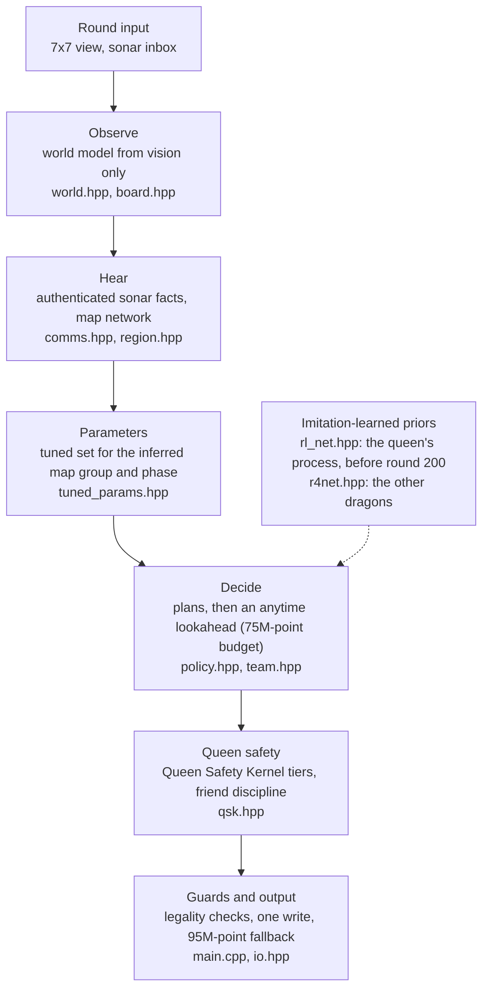
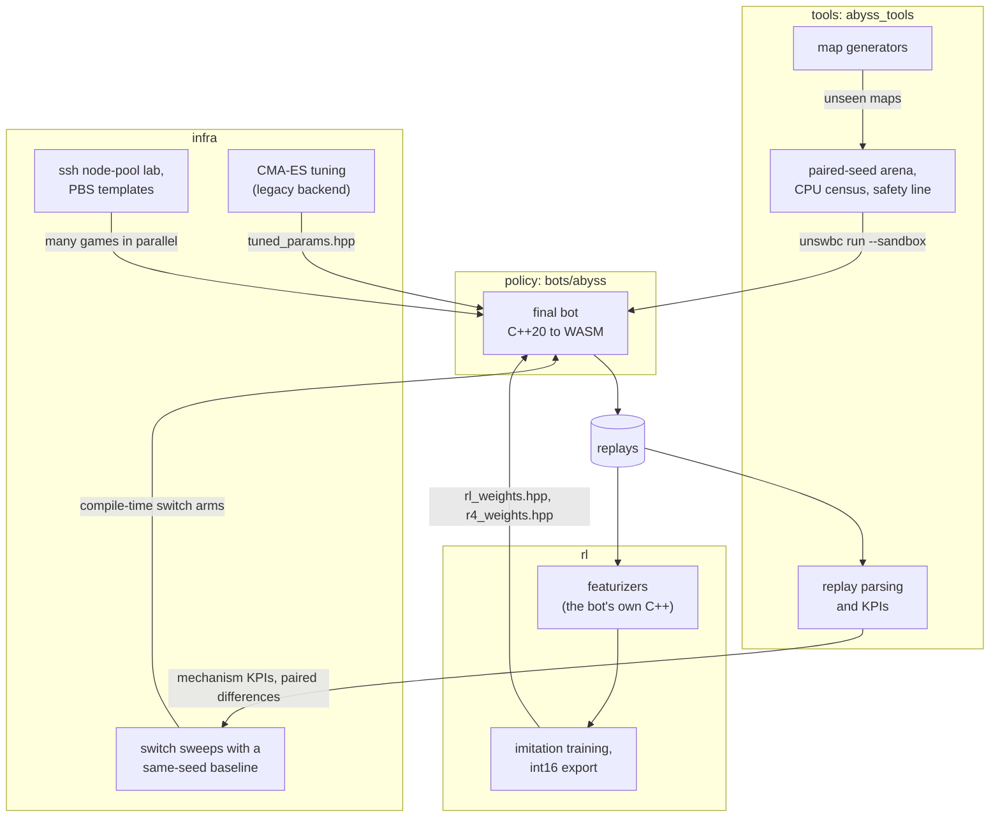

# Abyss: a UNSW Battlecode 2026 bot and its framework

[简体中文](README.zh-CN.md)

This is the competition bot of team **中国人必须飞👍🏿👍🏿👍🏿** for UNSW Battlecode 2026 "Abyss". The repository also
holds the training and evaluation framework we built around the bot: replay tools, a batch match platform, an
imitation-learning pipeline, tests and documentation.

> **Results**
>
> | | |
> | --- | --- |
> | peak Elo (ladder) | **1917** |
> | peak rank (ladder) | **#3** |
> | final submitted version | [`bots/abyss`](bots/abyss), released exactly as submitted |
> | its WASM (`unswbc` 1.2.9, `--sandbox`) | sha256 `0f39d15f10a503b5d5602144660b8c3d3e62cae53ed1fa94e792c88e395e3b0e` |
>
> Details and measured effects: [docs/results.md](docs/results.md).

## The game in one paragraph

Two teams control dragons (snakes) on a toroidal grid for 500 rounds. Each dragon runs as its own process. Our bot is
written in C++ and compiled to WASM by the official `unswbc` toolkit. Pearls grow a dragon by one segment, and a split
cuts one dragon into two. Teammates share no memory and can only talk through sonar messages. Under rules
1.2.3, dragons 0 and 1 are the two queens: at round 500 the longer queen decides the game. The full rules, in
implementer's terms, are in [docs/rules/game-rules.md](docs/rules/game-rules.md).

## Architecture

### The bot: one turn of one dragon

Every dragon is a separate process. A child created by a split starts with an empty world model and rebuilds it from
its own 7x7 view and from its teammates' sonar. The bot uses no map names, pearl timetables or opening books: it learns
each map during the game.



The search keeps the last word on tactics. The two networks only nudge the root moves, the split trigger and free
multi-step moves. Some modules are compiled in but switched off in the final build, for example the king end-game
library and the local fight search. They stay in the source because the release is byte-exact. See
[bots/abyss/README.md](bots/abyss/README.md) for the switch table and [docs/policy](docs/policy/README.md) for the
design.

### The framework



A change targets one mechanism and is judged first on that mechanism's KPI, then by its paired difference to a same-seed
baseline arm, not by raw win rate. Safety gates must pass whatever the results say: with the new switch off the build is
unchanged, a CPU census shows no timeout and no turn over 95M points, and on generated maps it was never developed on
the bot plays without timeouts or crashes. The ladder has the last word on a released version. The method is described
in [docs/methodology.md](docs/methodology.md).

## Modules

| module | path | what it is |
| --- | --- | --- |
| policy | [`bots/abyss`](bots/abyss/README.md) | the final bot, exactly as submitted: world model, sonar protocol, anytime search, Queen Safety Kernel, economy and end-game plans, two network priors, the 95M-point CPU fallback |
| test bots and maps | [`bots/fixtures`](bots/README.md#fixtures), [`bots/maps/unseen50`](bots/maps/unseen50/README.md) | two tiny bots for the worst-case CPU census; 50 generated maps that no bot was tuned on |
| tools | [`tools`](tools/README.md) | the Python package `abyss_tools`: replay parsing, KPIs, a paired-seed arena, the CPU census, the unseen-map safety line, switch sweeps, a decision harness and map generators |
| infra | [`infra`](infra/README.md) | batch evaluation on many machines (standalone scripts; `tools` is the single-machine package): an ssh node-pool lab, PBS templates, two-stage sweeps against a same-seed baseline, and a legacy CMA-ES tuning backend |
| rl | [`rl`](rl/README.md) | the imitation-learning pipeline behind the two priors: featurizers, record builders, training, int16 export, the in-bot runtime, a train/serve consistency test and an end-to-end example |
| tests | [`tests`](tests/README.md) | native C++ unit tests of the bot's modules, built from the bot's own headers |
| docs | [`docs`](docs/README.md) | rules, engine notes, architecture, methodology, history, results and the developer guide |

## Quick start

You need [uv](https://docs.astral.sh/uv/) (or pip) and a C++ compiler for native runs (installing `unswbc` with pip
needs Python 3.11 or newer; `uv tool install` picks a suitable Python itself). Then install the toolkit version the
final bot was built and verified with, and run every `unswbc` command from `bots/`:

```sh
uv tool install unswbc==1.2.9
cd bots
unswbc maps maps                                              # copies the 22 official maps into bots/maps
unswbc init cpp starter                                       # the toolkit's template bot, a baseline opponent
unswbc run maps/arena.map abyss starter                       # native build; the replay goes to bots/replays/
unswbc run maps/arena.map abyss starter --sandbox --seed 1    # as the judge runs it: WASM, CPU metered in points
```

The sandbox run also prints each team's CPU points per turn. The judge's limit is 100M, and in this game the bot's
turns peak at about 79M. A sandbox game with a fixed `--seed` replays identically. The judge's clang is compiled
for this machine once, by `unswbc init` or by the first sandbox run, whichever comes first (up to about a minute);
later runs reuse it.

**WASM cache.** `unswbc run --sandbox` caches the compiled WASM in
`${XDG_CACHE_HOME:-$HOME/.cache}/unswbc/wasmbots/<folder>-<key>.wasm`. The key covers only the `.c` / `.cc` / `.cpp`
files, so after you edit a header the old build runs silently. Delete it first:

```sh
find "${XDG_CACHE_HOME:-$HOME/.cache}/unswbc/wasmbots" -name 'abyss-*.wasm' -delete
```

To check that you run the released build, purge the cache, repeat the sandbox game above and hash the new file
(`sha256sum` on Linux):

```sh
shasum -a 256 "${XDG_CACHE_HOME:-$HOME/.cache}"/unswbc/wasmbots/abyss-*.wasm
# 0f39d15f10a503b5d5602144660b8c3d3e62cae53ed1fa94e792c88e395e3b0e
```

**Replays.** Open `bots/replays/*.replay` in the VS Code replay viewer (`unswbc vscode` installs it) or at
https://game.battlecode.au.

These commands create `bots/starter/`, the official maps in `bots/maps/`, `bots/replays/` and build folders inside the
checkout. The root [`.gitignore`](.gitignore) keeps them out of version control.

### Tools

Run these from the repository root (the quick start above ends inside `bots/`):

```sh
cd ..                                             # back to the repository root
uv venv && uv pip install -e "tools[full]"        # a .venv at the repository root
.venv/bin/abyss-replay-stats bots/replays/*.replay
```

`abyss-replay-stats` prints each game's result, deaths by reason, splits, peak army and timeouts. Its CPU column has a
value only when the replay records per-action instruction counts; replays written by a local `unswbc` 1.2.9 run do not,
so for local games read the CPU points per turn that the sandbox run prints, or use `abyss-cpu-census`. The package
installs 24 commands (`abyss-arena`, `abyss-cpu-census`, `abyss-opening-kpi`, ...). Each one prints its usage with
`--help`, and [tools/README.md](tools/README.md) shows typical workflows.

### Tests

From the repository root:

```sh
tests/native/run.sh                                                                  # C++ unit tests (any C++20 compiler)
(cd tools && uv run --with pycapnp --with numpy --with scipy --with pytest --with zstandard python -m pytest -q)
uv run --with pytest python -m pytest -q infra/tests
rl/tests/run_tests.sh                                                                # needs torch; uv fetches it
```

Python tests whose optional dependency is missing (`unswbc`, scipy, a compiler) skip themselves. The native tests
reach private members with `#define private public`, which libstdc++ does not accept, so when the compiler uses
libstdc++ (g++, the default `c++` on most Linux systems) `run.sh` includes every standard header first by itself
(`-include bits/stdc++.h`). CI
([`.github/workflows/ci.yml`](.github/workflows/ci.yml)) builds the bot natively with g++, runs the native tests,
checks the released bot's WASM hash with `unswbc` 1.2.9 `--sandbox`, and runs the tools and infra tests.

## Network weights

The final bot uses two small convolutional networks, published as generated C++ headers (int16 values with a float
scale per row):

- [`bots/abyss/rl_weights.hpp`](bots/abyss/rl_weights.hpp): the opening prior, used by the queen's process before
  round 200;
- [`bots/abyss/r4_weights.hpp`](bots/abyss/r4_weights.hpp): the move prior of the non-queen dragons.

> **Data statement:** trained by imitation on aggregated public ladder replays of top-ranked teams; contains no
> per-team model; the training data is not included.

[rl/README.md](rl/README.md) describes how to rebuild such networks from your own replays.

## Repository layout

```
.
├── bots/
│   ├── README.md          workspace setup, fixtures
│   ├── abyss/             the final bot, exactly as submitted (C++20, header-only modules)
│   │   └── king/          king end-game library (compiled, inactive in the final build)
│   ├── fixtures/          flooder and cpuhog: test bots for the worst-case CPU census
│   └── maps/unseen50/     50 generated maps for robustness checks
├── tools/                 abyss_tools: replays, KPIs, runners, map generators; pytest suite
├── infra/                 config, lab, PBS templates, sweeps, tuning; pytest suite
├── rl/                    featurize, data, train, runtime, integration, selfplay, eval, examples, tests
├── tests/
│   ├── README.md          how to run every test suite
│   └── native/            C++ unit tests of the bot's modules (run.sh, manifest.txt)
├── docs/                  rules, policy, methodology, history, results, developer guide
├── .github/workflows/     CI
├── .gitignore
├── CONTRIBUTING.md
├── LICENSE
├── README.md              this file
├── README.zh-CN.md        this file in Simplified Chinese
└── THIRD_PARTY_NOTICES.md
```

Every `README.md` has a Simplified Chinese version with the same content, `README.zh-CN.md`, in the same folder.

## Documentation

| document | contents |
| --- | --- |
| [docs/rules/game-rules.md](docs/rules/game-rules.md) | the game rules in implementer's terms ([简体中文](docs/rules/game-rules.zh-CN.md)) |
| [docs/rules/engine-notes.md](docs/rules/engine-notes.md) | measured engine facts: sonar mechanics, the virtual clock and the 95M fallback, the WASM build cache, the queen's identity, reproducibility |
| [docs/policy/README.md](docs/policy/README.md) | the final bot's architecture, layer by layer, and its compile-time switches |
| [docs/methodology.md](docs/methodology.md) | how changes were evaluated: mechanism KPIs, paired seeds, same-seed baselines, safety gates |
| [docs/history.md](docs/history.md) | how the bot evolved, and the lines that did not make it |
| [docs/results.md](docs/results.md) | ladder results, the final build's identity and measured effects ([简体中文](docs/results.zh-CN.md)) |
| [docs/dev-guide.md](docs/dev-guide.md) | working rules for changing the bot and verifying the released build |

The full index is [docs/README.md](docs/README.md).

## Contributors

- [@SongyuQi-Francisco](https://github.com/SongyuQi-Francisco)
- [@Tommyeth](https://github.com/Tommyeth)

## Acknowledgements

Thanks to UNSW CPMSoc for the Abyss game and the `unswbc` toolkit.

## Licence

MIT, see [LICENSE](LICENSE). Third-party files and their licences are listed in
[THIRD_PARTY_NOTICES.md](THIRD_PARTY_NOTICES.md). To contribute, see [CONTRIBUTING.md](CONTRIBUTING.md).
