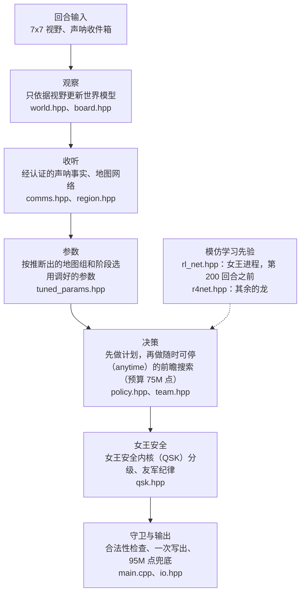
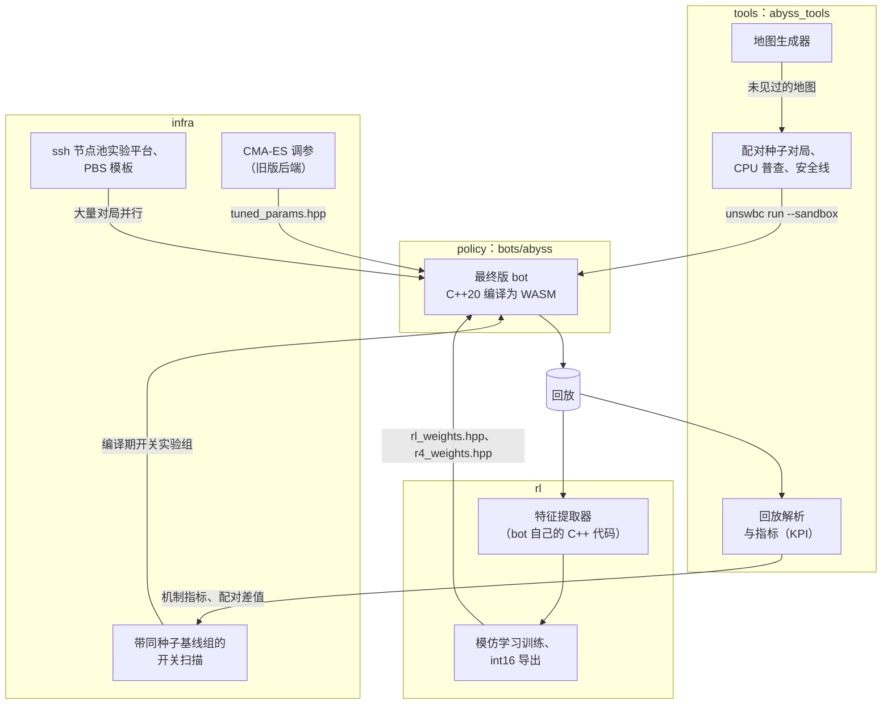

# Abyss：UNSW Battlecode 2026 参赛 bot 及其框架

[English](README.md)

这是队伍 **中国人必须飞👍🏿👍🏿👍🏿** 参加 UNSW Battlecode 2026 "Abyss" 的参赛 bot。仓库里还有我们围绕这个 bot 搭建的训练与评估框架：回放工具、批量对局平台、模仿学习管线、测试和文档。

> **成绩**
>
> | | |
> | --- | --- |
> | 最高 Elo（天梯） | **1917** |
> | 最高排名（天梯） | **第 3 名** |
> | 最终提交的版本 | [`bots/abyss`](bots/abyss)，按提交时的原样发布 |
> | 它的 WASM（`unswbc` 1.2.9，`--sandbox`） | sha256 `0f39d15f10a503b5d5602144660b8c3d3e62cae53ed1fa94e792c88e395e3b0e` |
>
> 详细数据和实测效果见 [docs/results.zh-CN.md](docs/results.zh-CN.md)。

## 一段话介绍这个游戏

两支队伍在环面网格上操控龙（蛇），一局 500 回合。每条龙作为独立进程运行。我们的 bot 用 C++ 编写，由官方工具包 `unswbc` 编译为 WASM。吃一颗珍珠，龙就长一节；一次分裂把一条龙分成两条。队友之间不共享内存，只能通过声呐（sonar）消息交流。按 1.2.3 版规则，编号 0 和 1 的龙是双方的女王：第 500 回合时由女王的长度决定胜负，更长的一方获胜。面向实现者的完整规则见 [docs/rules/game-rules.zh-CN.md](docs/rules/game-rules.zh-CN.md)。

## 架构

### bot：一条龙的一个回合

每条龙都是一个独立进程。分裂产生的子龙从空的世界模型开始，依靠自己的 7x7 视野和队友的声呐重建认知。bot 不使用地图名、珍珠时间表或开局库：每张地图都是在对局中现学的。



战术上的最终决定始终由搜索做出。两个网络只微调根节点的走法、分裂触发和免费多步移动。有些模块编译进了最终版本但处于关闭状态，例如国王残局库和局部战斗搜索。因为发布要求逐字节一致，它们仍留在源码中。开关表见 [bots/abyss/README.zh-CN.md](bots/abyss/README.zh-CN.md)，设计说明见 [docs/policy](docs/policy/README.zh-CN.md)。

### 框架



一项改动只针对一个机制，先看该机制的指标，再看它相对同种子基线组的配对差值，而不是看原始胜率。无论结果如何，安全门槛都必须通过：关闭新开关时，构建结果不变；CPU 普查中没有超时，也没有超过 95M 点的回合；在开发时从未用过的生成地图上，bot 对局没有超时或崩溃。已发布的版本最终由天梯说了算。方法详见 [docs/methodology.md](docs/methodology.md)（英文）。

## 模块

| 模块 | 路径 | 内容 |
| --- | --- | --- |
| policy | [`bots/abyss`](bots/abyss/README.zh-CN.md) | 最终版 bot，与提交版完全一致：世界模型、声呐协议、随时可停的搜索、女王安全内核、经济与终局计划、两个网络先验、95M 点 CPU 兜底 |
| 测试用 bot 与地图 | [`bots/fixtures`](bots/README.zh-CN.md#测试用-bot)、[`bots/maps/unseen50`](bots/maps/unseen50/README.zh-CN.md) | 两个用于最坏情况 CPU 普查的小型 bot；50 张没有任何 bot 针对其调过参的生成地图 |
| tools | [`tools`](tools/README.zh-CN.md) | Python 包 `abyss_tools`：回放解析、指标、配对种子对局、CPU 普查、未见地图安全线、开关扫描、decision harness 和地图生成器 |
| infra | [`infra`](infra/README.zh-CN.md) | 多台机器上的批量评估（独立脚本；`tools` 是单机用的包）：ssh 节点池实验平台、PBS 模板、对照同种子基线的两阶段扫描，以及旧版 CMA-ES 调参后端 |
| rl | [`rl`](rl/README.zh-CN.md) | 两个先验背后的模仿学习管线：特征提取器、记录构建、训练、int16 导出、bot 内运行时、训练 / 部署一致性测试和端到端示例 |
| tests | [`tests`](tests/README.zh-CN.md) | bot 各模块的原生 C++ 单元测试，直接用 bot 自己的头文件构建 |
| docs | [`docs`](docs/README.zh-CN.md) | 规则、引擎笔记、架构、方法论、演进历史、成绩和开发者指南 |

## 快速上手

需要 [uv](https://docs.astral.sh/uv/)（或 pip），本地原生对局还需要一个 C++ 编译器（用 pip 安装 `unswbc` 需要 Python 3.11 或更新版本；`uv tool install` 会自行选择合适的 Python）。先安装构建和校验最终版 bot 时用的工具包版本，然后在 `bots/` 目录下运行所有 `unswbc` 命令：

```sh
uv tool install unswbc==1.2.9
cd bots
unswbc maps maps                                              # 把 22 张官方地图复制到 bots/maps
unswbc init cpp starter                                       # 工具包的模板 bot，作为基准对手
unswbc run maps/arena.map abyss starter                       # 原生构建；回放写入 bots/replays/
unswbc run maps/arena.map abyss starter --sandbox --seed 1    # 与评测机相同的运行方式：WASM，CPU 按点数计价
```

sandbox 对局还会打印每支队伍每回合的 CPU 点数。评测机的上限是 100M；在这局里，bot 单回合最高约 79M。固定 `--seed` 的 sandbox 对局可以完全复现。评测用的 clang 只会为本机编译一次，发生在 `unswbc init` 或第一次 sandbox 运行时，以先到者为准（最多约一分钟），之后的运行会复用它。

**WASM 缓存。** `unswbc run --sandbox` 会把编译好的 WASM 缓存为 `${XDG_CACHE_HOME:-$HOME/.cache}/unswbc/wasmbots/<目录名>-<键>.wasm`。缓存键只覆盖 `.c` / `.cc` / `.cpp` 文件，所以修改头文件之后，运行的仍是旧的构建，而且不会有任何提示。先把它删掉：

```sh
find "${XDG_CACHE_HOME:-$HOME/.cache}/unswbc/wasmbots" -name 'abyss-*.wasm' -delete
```

要确认运行的就是发布版本：清空缓存，重跑上面的 sandbox 对局，再计算新文件的哈希（Linux 上用 `sha256sum`）：

```sh
shasum -a 256 "${XDG_CACHE_HOME:-$HOME/.cache}"/unswbc/wasmbots/abyss-*.wasm
# 0f39d15f10a503b5d5602144660b8c3d3e62cae53ed1fa94e792c88e395e3b0e
```

**回放。** 用 VS Code 回放查看器（`unswbc vscode` 会安装它）或在 https://game.battlecode.au 打开 `bots/replays/*.replay`。

上面这些命令会在仓库里生成 `bots/starter/`、`bots/maps/` 下的官方地图、`bots/replays/` 以及若干构建目录。根目录的 [`.gitignore`](.gitignore) 会把它们排除在版本控制之外。

### 工具

在仓库根目录执行（上面的快速上手最后停在 `bots/` 目录里）：

```sh
cd ..                                             # 回到仓库根目录
uv venv && uv pip install -e "tools[full]"        # 在仓库根目录创建 .venv
.venv/bin/abyss-replay-stats bots/replays/*.replay
```

`abyss-replay-stats` 打印每局的结果、按原因分类的死亡、分裂次数、最大兵力和超时情况。只有当回放记录了每个动作的指令计数时，它的 CPU 列才有数值；本地 `unswbc` 1.2.9 写出的回放不记录这一项，所以本地对局请看 sandbox 运行时打印的每回合 CPU 点数，或者使用 `abyss-cpu-census`。这个包一共安装 24 个命令（`abyss-arena`、`abyss-cpu-census`、`abyss-opening-kpi` 等）。每个命令都可以用 `--help` 打印用法；常见用法见 [tools/README.zh-CN.md](tools/README.zh-CN.md)。

### 测试

在仓库根目录执行：

```sh
tests/native/run.sh                                                                  # C++ 单元测试（任意 C++20 编译器）
(cd tools && uv run --with pycapnp --with numpy --with scipy --with pytest --with zstandard python -m pytest -q)
uv run --with pytest python -m pytest -q infra/tests
rl/tests/run_tests.sh                                                                # 需要 torch，由 uv 自动获取
```

缺少可选依赖（`unswbc`、scipy、编译器）的 Python 测试会自动跳过。原生测试通过 `#define private public` 访问私有成员，而 libstdc++ 不接受这种写法；因此当编译器使用 libstdc++（g++，即大多数 Linux 系统上默认的 `c++`）时，`run.sh` 会自动先包含全部标准头文件（`-include bits/stdc++.h`）。CI（[`.github/workflows/ci.yml`](.github/workflows/ci.yml)）会用 g++ 原生构建 bot、运行原生测试，用 `unswbc` 1.2.9 `--sandbox` 校验发布版 bot 的 WASM 哈希，并运行 tools 和 infra 的测试。

## 网络权重

最终版 bot 用到两个小型卷积网络，以生成的 C++ 头文件形式发布（int16 数值，每行一个 float 缩放系数）：

- [`bots/abyss/rl_weights.hpp`](bots/abyss/rl_weights.hpp)：开局先验，女王进程在第 200 回合之前使用；
- [`bots/abyss/r4_weights.hpp`](bots/abyss/r4_weights.hpp)：非女王龙的走法先验。

> **数据声明（Data statement）：** trained by imitation on aggregated public ladder replays of top-ranked teams; contains
> no per-team model; the training data is not included.
>
> 译文：基于排名靠前队伍的公开天梯回放的聚合数据，通过模仿学习训练；不包含任何针对单个队伍的模型；训练数据不随本仓库发布。

如何用自己的回放重新训练这类网络，见 [rl/README.zh-CN.md](rl/README.zh-CN.md)。

## 仓库结构

```
.
├── bots/
│   ├── README.md          工作区搭建、测试用 bot
│   ├── abyss/             最终版 bot，与提交版完全一致（C++20，纯头文件模块）
│   │   └── king/          国王残局库（已编译，在最终版本中不起作用）
│   ├── fixtures/          flooder 和 cpuhog：用于最坏情况 CPU 普查的测试 bot
│   └── maps/unseen50/     50 张用于稳健性检查的生成地图
├── tools/                 abyss_tools：回放、指标、对局运行器、地图生成器；pytest 测试
├── infra/                 配置、实验平台、PBS 模板、扫描、调参；pytest 测试
├── rl/                    featurize、data、train、runtime、integration、selfplay、eval、examples、tests
├── tests/
│   ├── README.md          如何运行各套测试
│   └── native/            bot 各模块的 C++ 单元测试（run.sh、manifest.txt）
├── docs/                  规则、策略、方法论、演进历史、成绩、开发者指南
├── .github/workflows/     CI
├── .gitignore
├── CONTRIBUTING.md
├── LICENSE
├── README.md              英文版说明
├── README.zh-CN.md        本文件（简体中文版）
└── THIRD_PARTY_NOTICES.md
```

每个 `README.md` 在同一目录下都有一份内容相同的简体中文版 `README.zh-CN.md`。

## 文档

| 文档 | 内容 |
| --- | --- |
| [docs/rules/game-rules.zh-CN.md](docs/rules/game-rules.zh-CN.md) | 面向实现者的游戏规则（[English](docs/rules/game-rules.md)） |
| [docs/rules/engine-notes.md](docs/rules/engine-notes.md)（英文） | 实测的引擎事实：声呐机制、虚拟时钟与 95M 兜底、WASM 构建缓存、女王身份、可复现性 |
| [docs/policy/README.zh-CN.md](docs/policy/README.zh-CN.md) | 最终版 bot 的逐层架构及其编译期开关 |
| [docs/methodology.md](docs/methodology.md)（英文） | 如何评估改动：机制指标、配对种子、同种子基线、安全门槛 |
| [docs/history.md](docs/history.md)（英文） | bot 的演进过程，以及没有走通的路线 |
| [docs/results.zh-CN.md](docs/results.zh-CN.md) | 天梯成绩、最终构建的身份和实测效果（[English](docs/results.md)） |
| [docs/dev-guide.md](docs/dev-guide.md)（英文） | 修改 bot 的工作规则，以及如何校验发布的构建 |

完整索引见 [docs/README.zh-CN.md](docs/README.zh-CN.md)。

## 贡献者

- [@SongyuQi-Francisco](https://github.com/SongyuQi-Francisco)
- [@Tommyeth](https://github.com/Tommyeth)

## 致谢

感谢 UNSW CPMSoc 提供 Abyss 这个游戏和 `unswbc` 工具包。

## 许可证

MIT，见 [LICENSE](LICENSE)。第三方文件及其许可证列在 [THIRD_PARTY_NOTICES.md](THIRD_PARTY_NOTICES.md)（英文）中。参与贡献请看 [CONTRIBUTING.md](CONTRIBUTING.md)（英文）。
