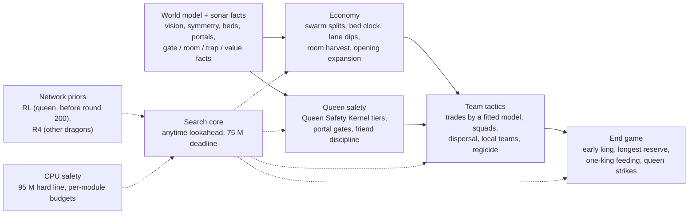
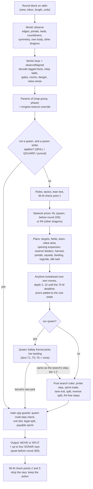

# Policy architecture of the final bot

[简体中文](README.zh-CN.md)

This directory documents the decision policy of the final submitted bot, [`bots/abyss`](../../bots/abyss), as it is
compiled. Everything here was written from the code. Where an old design note and the code disagree, the code wins and
the note is not repeated. File and line pointers (`file:line`) refer to `bots/abyss`.

## The bot in one paragraph

Every dragon is its own process with no shared memory: a split child starts empty and rebuilds what it knows from its
own 7x7 view and from its teammates' sonar. Each turn a dragon (1) updates a world model learnt from vision only (walls,
portals, pearl beds and their refill gaps, the map's mirror symmetry, enemy sightings, both queens), (2) reads and
relays authenticated 64-bit sonar facts, (3) picks the tuned parameter set of the map group it believes it is on and of
the game phase, (4) scores its four possible first steps with an anytime lookahead over its own move sequences, using
hand-written value and danger terms nudged by two small imitation-learned networks, and (5) passes the result through
safety layers: the Queen Safety Kernel for our queen, "friend discipline" for the dragons around her, and last legality
guards. No map names, pearl timetables or opening books are used; everything the bot knows about a map it learns during
the game.

The rules that shape the design (rules 1.2.3, toolkit `unswbc` 1.2.3 to 1.2.9; see
[../rules/game-rules.md](../rules/game-rules.md)): 500 rounds on a torus; a pearl grows a dragon by one segment; a
dragon of length L that dies drops ceil(L/2) pearls; a multi-step `MOVE` takes its first ceil(L/4) steps free and pays
one tail segment for each further step; dragons 0 and 1 are the queens, and after round 500 the longer queen wins (a
dead queen counts 0), then the longest dragon, then total length; at most 64 dragons per team.

## Layers

RL and R4 are the code's names for the two imitation-learned nets: RL = the opening prior (`rl_net.hpp`, `RLNet`,
`BC_RL_PRIOR`, used by the queen's process before round 200), R4 = the move prior (`r4net.hpp`, every other dragon); see
[net-priors.md](net-priors.md).

| layer | what it decides | main code | document |
|---|---|---|---|
| World model and sonar facts | what this dragon believes about the map, the pearls, teammates and enemies | `world.hpp`, `board.hpp`, `comms.hpp`, `region.hpp` | [mapnet.md](mapnet.md) |
| Search core | the value of each of the four moves, by an anytime lookahead | `policy.hpp` (`decide`, `scoreFrom`, `searchFrom`) | [search-core.md](search-core.md) |
| Economy | splitting, foraging, bed timing, lanes and fountain rooms, opening expansion | `policy.hpp` (`trySplit`, lane dips, bed clock, harvest, `planOpenExpand`) | [economy-and-expansion.md](economy-and-expansion.md) |
| Queen safety | where our queen may land, and what teammates must not do around her | `qsk.hpp`, `policy.hpp`, `world.hpp` (portal gates) | [queen-safety.md](queen-safety.md) |
| Team tactics | trades, squads, dispersal, local teams, hunting the enemy queen | `policy.hpp`, `team.hpp` | [search-core.md](search-core.md), [endgame.md](endgame.md) |
| End game | who keeps length for round 500, who feeds whom, killing the enemy queen | `policy.hpp` (feeding block, reserve, QKILL, regicide) | [endgame.md](endgame.md) |
| Network priors | two imitation-learned priors on the root moves, the split trigger and free steps | `rl_net.hpp`, `r4net.hpp`, `rl_features.hpp` | [net-priors.md](net-priors.md) |
| CPU safety | per-module clock budgets, the 95 M-point fallback, how it was measured | `common.hpp` (`fb95`), `io.hpp`, `main.cpp` | [cpu-safety.md](cpu-safety.md) |

[switches.md](switches.md) lists every compile-time switch with its value in the final build and whether its code runs.
[lessons.md](lessons.md) collects approaches that were built, measured and not kept.

## One turn of one dragon

## What happens when in a game

| rounds | active rules (final build) |
|---|---|
| 0-120 | opening expansion toward free bed areas, on maps of at most 700 tiles |
| 0-199 | RL opening prior and split trigger for the queen's process; R4 split trigger for the other dragons; our queen eats first while she is shorter than 5 (GROWFIRST) |
| 0-299 | the bed spawn clock (wait value, countdown completion, unlock, no-block, idle-to-bed); sonar quiet except event facts |
| 0-399 | the swarm: every dragon of length 4 or more that is not the early king, not the reserve and not leaving a pocket splits in half when the split is safe, even on a turn that eats and even in a crowd |
| 200+ | the early king: the longest known dragon of length 8 or more keeps every segment, looks further for food, and the others leave its food and its surroundings; other dragons leave two unit slots free |
| 300+ | sonar every turn; the longest non-queen dragon becomes the reserve (eats first, never splits) with two feeders; with 40 or more units, each free dragon of length 8 or less heads for the nearest enemy head seen or heard within 6 rounds |
| 350+ | dragons of length 10 or more reverse-split only when (nearly) boxed in; the one-king feeding rule is enabled (it acts inside the feeding window) |
| 400-489 | no more voluntary splits (a boxed-in dragon may still reverse-split); danger weights doubled; feeding window: a non-queen dragon that sees the team's longest dragon (by LONGEST facts), at least as long as itself, walks to it and dies next to its head |
| all game | Queen Safety Kernel, friend discipline around our queen, portal gates, map-network facts, QKILL / QGUARD / regicide, R4 move prior, 95 M fallback |

## Compiled but inactive code

The final build is released byte for byte: its WASM, built by `unswbc` 1.2.9 with `--sandbox`, has SHA-256
`0f39d15f10a503b5d5602144660b8c3d3e62cae53ed1fa94e792c88e395e3b0e`. The source therefore keeps code that never runs.
Removing it is not safe even when it is dead: the judge meters instructions, the search stops on that meter, and a
different binary changes how deep the search gets on a given turn and so changes games. Three kinds of inactive code
remain:

- modules behind `#if` switches that are 0 in the final build (they compile to nothing);
- modules that are compiled but switched off by a run-time value, for example the local fight search (its weight is 0 in
  every tuned context) and the king library in `v10k.hpp` and `king/` (its first round, `V10K_R0`, is 501 in a 500-round
  game);
- code paths shadowed by another module, for example the queen's 2-3 step flee search (replaced by the Queen Safety
  Kernel) and the slay planner (replaced by the regicide planner).

[switches.md](switches.md) marks each of them.

## Reading order

1. This page, then [search-core.md](search-core.md): the turn loop, the clock and the value function.
2. [mapnet.md](mapnet.md): what a dragon knows and how teammates share it.
3. [economy-and-expansion.md](economy-and-expansion.md) and [queen-safety.md](queen-safety.md): the two layers that
   decide most games.
4. [endgame.md](endgame.md) and [net-priors.md](net-priors.md).
5. [cpu-safety.md](cpu-safety.md) before changing anything that runs every turn.
6. [switches.md](switches.md) as the reference, and [lessons.md](lessons.md) before trying an idea that may already have
   been measured.

## Source files of `bots/abyss`

| file | role |
|---|---|
| `main.cpp` | the turn loop, legality guards, sonar scheduling, the fallback check points |
| `io.hpp` | the protocol parser and the single buffered write per turn |
| `common.hpp` | compile-time switches and their defaults, `Params`, fixed constants, the virtual clock, the 95 M line |
| `ablation.hpp` | the final build's switch settings (they override the defaults in `common.hpp`) |
| `tuned_params.hpp` | generated: the tuned `Params` per (map group, phase) |
| `board.hpp`, `nav.hpp` | torus geometry, edges, portal stepping, dead-end tiles; time-aware BFS and flood fill |
| `world.hpp` | the per-process world model, sonar facts in and out, symmetry, portal gates, map-network hooks |
| `comms.hpp`, `region.hpp` | the 64-bit fact format with its tag; the gate table, the danger layer and the (inactive) room graph |
| `team.hpp` | local teams: membership, leader, TEAM facts |
| `policy.hpp` | the per-dragon decision: plans, search, splits, trades, queen rules, free steps |
| `qsk.hpp` | the Queen Safety Kernel |
| `rl_features.hpp`, `rl_net.hpp`, `r4net.hpp`, `rl_weights.hpp`, `r4_weights.hpp` | the observation features and the two networks with their int16 weights |
| `fight.hpp` | the local fight search (compiled, inactive) |
| `v10k.hpp`, `king/` | the king library for the end game (compiled, never runs) |
