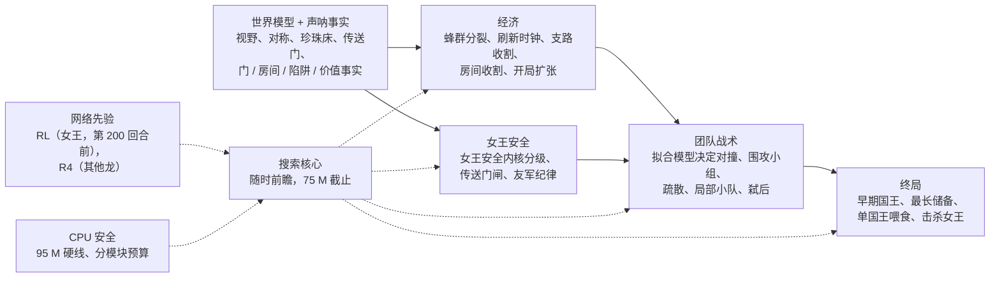
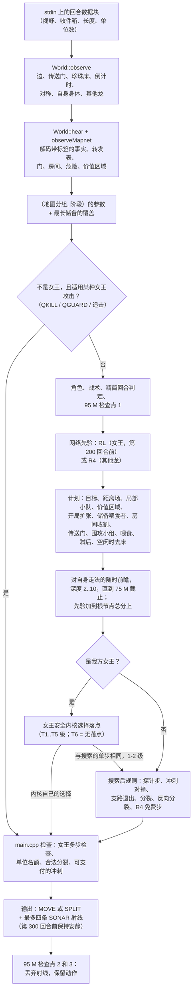

# 最终版 bot 的策略架构

[English](README.md)

本目录记录最终提交的 bot [`bots/abyss`](../../bots/abyss) 实际编译出来的决策策略。所有内容都依据代码写成；旧设计笔记与代码不一致时以代码为准，笔记内容不再复述。文中的文件与行号指针（`file:line`）指向 `bots/abyss`。

## 一段话概括

每条龙都是一个独立进程，彼此不共享内存：分裂出的子龙从零开始，只靠自己的 7x7 视野和队友的声呐重建认知。每回合一条龙会：(1) 只根据视野更新世界模型（墙、传送门、珍珠床及其刷新间隔、地图的镜像对称、看到的敌人、双方女王）；(2) 读取并转发经过认证的 64 位声呐事实；(3) 按它判断所在的地图分组和当前对局阶段选取调好的参数集；(4) 用对自身走法序列的随时（anytime）前瞻搜索给四个可能的第一步打分，打分用手写的价值项和危险项，再由两个通过模仿学习训练的小网络微调；(5) 把结果交给几层安全机制：我方女王的女王安全内核（Queen Safety Kernel）、约束她周围队友的“友军纪律”，以及最后的合法性检查。bot 不使用地图名、珍珠时间表或开局库；它对一张地图的全部了解都是在对局中学到的。

塑造这套设计的规则（规则 1.2.3，工具包 `unswbc` 1.2.3 至 1.2.9；见 [../rules/game-rules.zh-CN.md](../rules/game-rules.zh-CN.md)）：环面地图上进行 500 回合；吃一颗珍珠长一节；长度为 L 的龙死亡时掉落 ceil(L/2) 颗珍珠；多步 `MOVE` 的前 ceil(L/4) 步免费，之后每多走一步付出一节尾巴；0 号和 1 号龙是女王，第 500 回合后先比女王长度（死亡的女王记 0），再比最长龙，再比总长度；每队最多 64 条龙。

## 分层

RL 和 R4 是代码中两个模仿学习网络的名字：RL 是开局先验（`rl_net.hpp`、`RLNet`、`BC_RL_PRIOR`，女王进程在第 200 回合之前使用），R4 是走法先验（`r4net.hpp`，其他所有龙使用）；详见 [net-priors.md](net-priors.md)（英文）。

| 层 | 决定什么 | 主要代码 | 文档 |
|---|---|---|---|
| 世界模型与声呐事实 | 这条龙对地图、珍珠、队友和敌人的认知 | `world.hpp`、`board.hpp`、`comms.hpp`、`region.hpp` | [mapnet.md](mapnet.md)（英文） |
| 搜索核心 | 用随时前瞻给四个走法估值 | `policy.hpp`（`decide`、`scoreFrom`、`searchFrom`） | [search-core.md](search-core.md)（英文） |
| 经济 | 分裂、觅食、珍珠床的刷新时机、支路与喷泉房间、开局扩张 | `policy.hpp`（`trySplit`、支路收割、刷新时钟、房间收割、`planOpenExpand`） | [economy-and-expansion.md](economy-and-expansion.md)（英文） |
| 女王安全 | 我方女王可以落在哪里，以及队友在她身边不能做什么 | `qsk.hpp`、`policy.hpp`、`world.hpp`（传送门闸） | [queen-safety.md](queen-safety.md)（英文） |
| 团队战术 | 对撞、围攻小组、疏散、局部小队、猎杀敌方女王 | `policy.hpp`、`team.hpp` | [search-core.md](search-core.md)（英文）、[endgame.md](endgame.md)（英文） |
| 终局 | 谁为第 500 回合保留长度、谁喂谁、击杀敌方女王 | `policy.hpp`（喂食块、储备、QKILL、弑后） | [endgame.md](endgame.md)（英文） |
| 网络先验 | 两个模仿学习得到的先验：作用于根节点走法、分裂触发和免费步 | `rl_net.hpp`、`r4net.hpp`、`rl_features.hpp` | [net-priors.md](net-priors.md)（英文） |
| CPU 安全 | 各模块的时钟预算、95 M 点兜底及其测量方法 | `common.hpp`（`fb95`）、`io.hpp`、`main.cpp` | [cpu-safety.md](cpu-safety.md)（英文） |

[switches.md](switches.md)（英文）列出每个编译期开关在最终版中的取值，以及对应代码是否实际运行。[lessons.md](lessons.md)（英文）汇总了做过、测过但没有保留的方案。

## 一条龙的一个回合

## 对局中各阶段生效的规则

| 回合 | 生效规则（最终版） |
|---|---|
| 0-120 | 开局扩张：在不超过 700 格的地图上向空闲的床区推进 |
| 0-199 | 女王进程使用 RL 开局先验和分裂触发；其他龙使用 R4 分裂触发；女王短于 5 时优先进食（GROWFIRST） |
| 0-299 | 刷新时钟（等待价值、倒计时补全、解锁、不阻挡、空闲时去床）；除事件类事实外声呐保持安静 |
| 0-399 | 蜂群：每条长度 4 及以上、且不是早期国王、不是储备、不在离开口袋的龙，只要分裂安全就对半分裂，即使这一步在进食、即使身处拥挤 |
| 200+ | 早期国王：已知最长且长度至少 8 的龙保留全部身段、看得更远去找食物，其他龙把它周围的食物和空间让给它；其他龙留出两个单位名额 |
| 300+ | 每回合都发声呐；最长的非女王龙成为储备（优先进食、从不分裂），配两个喂食者；单位数 40 及以上时，每条长度不超过 8 的空闲龙前往 6 回合内见到或听到的最近敌方龙头 |
| 350+ | 长度 10 及以上的龙只有在（几乎）被围死时才反向分裂；单国王喂食规则启用（在喂食窗口内起作用） |
| 400-489 | 不再主动分裂（被困时仍可反向分裂）；危险权重加倍；喂食窗口：看到全队最长龙（依据 LONGEST 事实）且它不短于自己的非女王龙走过去，死在它的头旁边 |
| 全程 | 女王安全内核、我方女王周围的友军纪律、传送门闸、地图网络事实、QKILL / QGUARD / 弑后、R4 走法先验、95 M 兜底 |

## 编译进来但不运行的代码

最终版按字节原样发布：用 `unswbc` 1.2.9 加 `--sandbox` 构建出的 WASM 的 SHA-256 为 `0f39d15f10a503b5d5602144660b8c3d3e62cae53ed1fa94e792c88e395e3b0e`。因此源码保留了从不运行的代码。即使是死代码，删除也不安全：评测按指令计量，搜索在这个计量时钟上停止，换一个二进制就会改变某回合的搜索深度，从而改变对局。仍保留三类不运行的代码：

- 由最终版中取值为 0 的 `#if` 开关包住的模块（编译后不存在）；
- 编译进来但被运行期取值关闭的模块，例如局部战斗搜索（它的权重在所有调参情境下都是 0），以及 `v10k.hpp` 与 `king/` 中的国王残局库（它的起始回合 `V10K_R0` 为 501，而一局只有 500 回合）；
- 被其他模块取代的代码路径，例如女王的 2-3 步逃跑搜索（被女王安全内核取代）和 slay 规划器（被弑后规划器取代）。

[switches.md](switches.md)（英文）对它们逐一做了标注。

## 阅读顺序

1. 本页，然后是 [search-core.md](search-core.md)（英文）：回合循环、时钟和价值函数。
2. [mapnet.md](mapnet.md)（英文）：一条龙知道什么，以及队友之间如何共享。
3. [economy-and-expansion.md](economy-and-expansion.md)（英文）和 [queen-safety.md](queen-safety.md)（英文）：决定大多数对局的两层。
4. [endgame.md](endgame.md)（英文）和 [net-priors.md](net-priors.md)（英文）。
5. 修改任何每回合都会运行的代码之前，先读 [cpu-safety.md](cpu-safety.md)（英文）。
6. [switches.md](switches.md)（英文）作为参考；尝试某个想法之前先看 [lessons.md](lessons.md)（英文），它可能已经被测过。

## `bots/abyss` 的源文件

| 文件 | 作用 |
|---|---|
| `main.cpp` | 回合循环、合法性检查、声呐调度、兜底检查点 |
| `io.hpp` | 协议解析，以及每回合一次的缓冲写出 |
| `common.hpp` | 编译期开关及其默认值、`Params`、固定常量、虚拟时钟、95 M 硬线 |
| `ablation.hpp` | 最终版的开关设定（覆盖 `common.hpp` 中的默认值） |
| `tuned_params.hpp` | 生成文件：按（地图分组, 阶段）调好的 `Params` |
| `board.hpp`、`nav.hpp` | 环面几何、边、穿越传送门、死胡同格；带时间的 BFS 与洪泛 |
| `world.hpp` | 每个进程的世界模型、声呐事实的收发、对称、传送门闸、地图网络钩子 |
| `comms.hpp`、`region.hpp` | 带标签的 64 位事实格式；门表、危险层和（未启用的）房间图 |
| `team.hpp` | 局部小队：成员、领队、TEAM 事实 |
| `policy.hpp` | 每条龙的决策：计划、搜索、分裂、对撞、女王规则、免费步 |
| `qsk.hpp` | 女王安全内核 |
| `rl_features.hpp`、`rl_net.hpp`、`r4net.hpp`、`rl_weights.hpp`、`r4_weights.hpp` | 观测特征，以及两个网络和它们的 int16 权重 |
| `fight.hpp` | 局部战斗搜索（编译进来，不运行） |
| `v10k.hpp`、`king/` | 国王残局库（编译进来，从不运行） |
