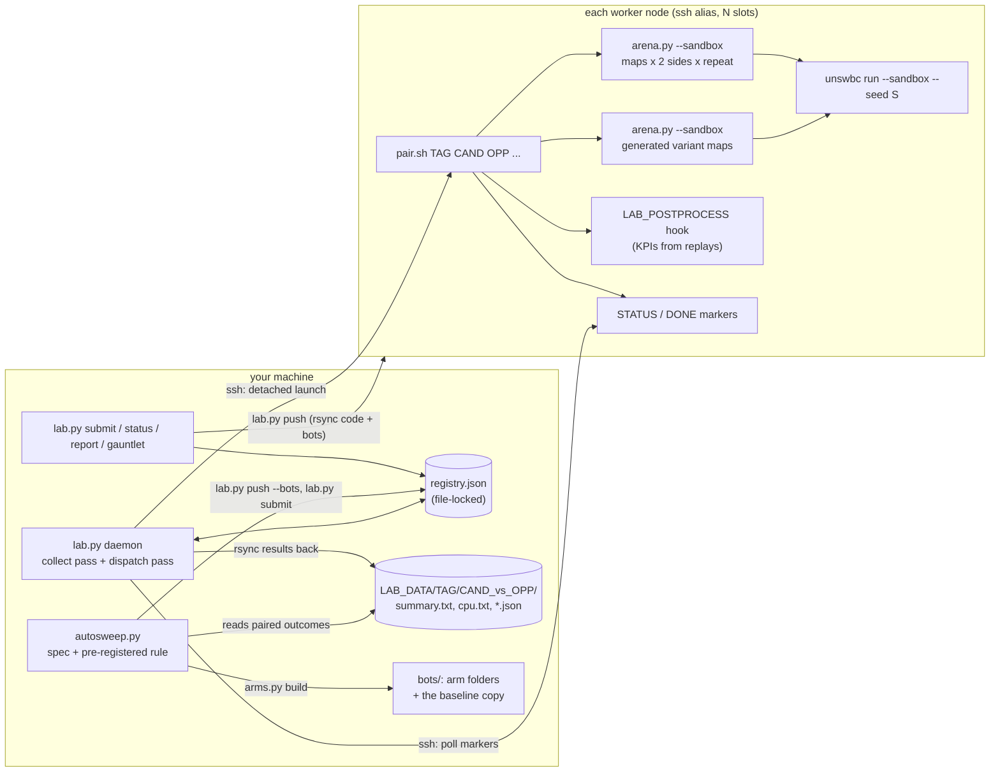

# infra: the batch evaluation platform

[简体中文](README.zh-CN.md)

Everything we used to play bots against each other in bulk: thousands of judge-exact sandbox games per day, spread
over a pool of ssh machines or a PBS cluster, with paired seeds and a same-seed baseline so that small differences
between two versions of a bot can be measured at all. Nothing here is specific to our bot except the example
configuration; every host, user, path and queue comes from your own configuration files.

| folder | what |
| --- | --- |
| [`config/`](config/) | example configuration: `example.env` (environment), `nodes.example.toml` (node pool), `mapsets.example.toml` (map sets), `judges.example.txt` (judged opponents of a sweep) |
| [`lab/`](lab/) | the ssh node-pool scheduler `lab.py` (registry, dispatcher, collector, reports), the node-side `pair.sh`, the paired-seed match runner `arena.py`, the CPU check `cpu_check.py`, configuration loader `labconf.py` |
| [`sweep/`](sweep/) | `arms.py` (compile-time macro arms + same-seed baseline + paired report) and `autosweep.py` (a continuous two-stage, pre-registered sweep with confirmation on fresh seeds), `sweep_spec.example.json` |
| [`pbs/`](pbs/) | generic PBS templates: one arena run, a CPU census, a whole census (`census.sh`), a post-processing job, replay compression, tuning islands |
| [`tuning/`](tuning/) | optional, legacy backend: island-model CMA-ES over a bot's `Params` against a self-evolving league |
| [`tests/`](tests/) | unit tests of the scheduler, the parsers, the sweep rule and the tuning space |

All commands run from the repository root. The bots live in the unswbc workspace `bots/` (override with
`BC_BOTS_DIR`); a bot is a folder name there (`abyss`, `starter`, ...). Local results go to `data/lab/` (`LAB_DATA`),
which should stay out of version control.

**infra or tools?** [`tools/`](../tools/README.md) (the pip-installable `abyss_tools` package) is for one machine. The
scripts here are standalone (the scheduler, the runner and the sweeps use only the Python standard library, so worker
nodes need just `python3` and `unswbc`) and drive many machines. Both use the same paired-seed scheme, so their results
can be compared slot by slot. Note the different environment variable for the bots folder: `ABYSS_BOTS` (tools) and
`BC_BOTS_DIR` (infra).

## Architecture



A **census** is a set of pairs (candidate vs opponent) submitted under one tag. A **pair** is one run of `pair.sh` on
one node: the candidate plays the opponent on a map list, both sides, `repeat` times, plus `pv` generated variant
maps (both sides), all in the judge's sandbox. The scheduler is a single local process with a JSON registry: no
database, no agent on the nodes, only `ssh` and `rsync`. On a PBS cluster the same census is a set of jobs submitted
by `pbs/census.sh`, with the same result layout.

## Setting up a node pool

1. **ssh aliases.** Give every worker an alias in `~/.ssh/config`; host names, users and keys stay there, never in
   this repository:

   ```
   Host worker-a
       HostName <address of the machine>
       User <your user>
       IdentityFile ~/.ssh/<your key>
   ```

   Key-based, non-interactive login is required (`lab.py` uses `ssh -o BatchMode=yes`).

2. **Prepare each node.** Linux with `python3`, `rsync`, optionally `zstd`, and **the same unswbc version as the
   judge** (we used 1.2.9). Pin it per node if needed and point `LAB_REMOTE_ENV` at it (see `config/example.env`). Run
   one game by hand once per node: the first sandbox build compiles the judge's toolchain (about a minute), which
   later runs share.

3. **Describe the pool.** `cp infra/config/nodes.example.toml infra/config/nodes.toml` and list `alias = slots`.
   Slots are games a node runs at once; **memory, not cores, is the limit**: a sandbox game of a large bot averages
   about 2.4 GB and peaks near 4.4 GB, and a node past its memory meets the OOM killer, which loses games silently.
   A safe rule is `slots = min(cores - 2, memory_GB / 4.4)`.

4. **Environment.** `cp infra/config/example.env infra/config/lab.env` and edit. The copies are git-ignored. Every
   setting can also be given as an environment variable (which wins over the file).

5. **Push and check.**

   ```sh
   python3 infra/lab/lab.py push            # rsync bots/ and infra/ (LAB_PUSH) to <LAB_REMOTE_ROOT> on every node
   python3 infra/lab/lab.py nodes           # load, cores and running pairs per node
   ```

## Submitting and collecting a census

Here `abyss_base` and `abyss_ref` are renamed copies of the bot (`cp -r bots/abyss bots/abyss_base`): the first is the
same-seed baseline the arms are read against, the second a frozen copy of your current release as an opponent.

```sh
# 1. queue: every candidate against every opponent, on a map set from the map sets file
python3 infra/lab/lab.py submit t1 "abyss_base abyss_arm1 abyss_arm2" "starter abyss_ref" --set official --repeat 2
python3 infra/lab/lab.py run --dry-run           # what a dispatch pass would start now
# 2. dispatch + collect continuously (or call `run` and `collect` yourself)
nohup python3 infra/lab/lab.py daemon --every 60 >> data/lab/daemon.out 2>&1 &
# 3. read
python3 infra/lab/lab.py status t1               # the registry
python3 infra/lab/lab.py report t1               # W-L per pair with a 95% Wilson interval, CPU failures, worst turn
python3 infra/lab/lab.py gauntlet t1             # candidates x opponents, mean and worst opponent per candidate
python3 infra/lab/lab.py replays t1 abyss_arm1_vs_starter   # fetch one pair's replays
python3 infra/lab/cpu_check.py data/lab/t1/abyss_arm1_vs_starter --limit 95
# housekeeping
python3 infra/lab/lab.py prio t1 "abyss_arm1_vs_starter" 1   # lower = sooner
python3 infra/lab/lab.py cancel t1 [PAIR]                    # pending pairs dropped, running ones killed on their node
touch data/lab/PAUSE                                         # no new launches (node maintenance); rm to resume
```

What happens:

- `submit` adds one registry entry per (tag, candidate, opponent); duplicates and self-pairs are skipped.
- A **dispatch pass** sorts pending pairs by priority, then submission time, and starts each on the node with the most
  free slots, detached (`nohup setsid`, no stdin) so ssh returns at once. The registry is saved before the launch, so
  a crash never leaves an unrecorded run.
- A **collect pass** asks each busy node for its `STATUS` / `DONE` markers, copies finished pairs back with rsync
  (summaries, CPU tables, logs, the hook's JSON - not the replays), parses them and logs the W-L.
- **Big-pair scheduling:** a pair with more than `big_games` games waits for at least `big_min` free slots (started on
  a two-slot leftover it would run for hours), and while it waits it reserves the freest node against lower-priority
  pairs; otherwise small pairs keep taking the leftovers there and the big pair never starts. Small pairs fill the
  leftovers everywhere else.
- Results land in `$LAB_DATA/TAG/CAND_vs_OPP/{orig,pv}/` (`summary.txt`: one row per game from the candidate's side;
  `cpu.txt`: worst turn and lost turns per game) plus `CAND_vs_OPP.json` when the hook writes one. Replays stay on
  the node (zstd-compressed) until `lab.py replays` fetches them.
- `LAB_POSTPROCESS` (optional) runs on the node after the games as `bash -c "$LAB_POSTPROCESS" _ CAND PAIR_DIR
  RUN_DIR...`, e.g. a KPI script from [`tools/`](../tools/) over the fresh replays; `LAB_REPORT_CMD` adds your own
  table to `lab.py report`.

For a single machine, `infra/lab/arena.py` is the same runner without the scheduler:

```sh
python3 infra/lab/arena.py abyss starter --sandbox -j 8 --maps default arena maze --repeat 2 -o runs/abyss_vs_starter
```

## The statistical method

A Battlecode bot is a large, noisy, deterministic system, and the differences worth finding between two versions are
a few percent. With random seeds, a census of about 120 games has a 95% interval of roughly plus or minus 9 points
on a win rate; most real changes are smaller than that. The platform is built around five rules.

1. **Paired seeds.** The seed of a game is a hash of its slot (map, which side the candidate plays, repeat) plus a
   seed base (`arena.py --seed-base`). Every candidate played against the same opponent meets the same pearl respawns
   and the same random numbers in the same slot, so two candidates' results differ by their play, not by the draw.
   Pairs are compared slot by slot. A new seed base gives a fresh, independent set of games. `--fork` gives both
   sides of a (map, repeat) the same seed: a candidate that only changes the end game then plays the very same game
   as its control until the change.

2. **A same-seed baseline arm, not 50%.** On a fixed set of paired seeds even an identical bot does not score 50%:
   the seed set has its own bias (map and side draws). Every census therefore includes the unchanged bot under another
   folder name (`arms.py build` makes `<prefix>base_c`) on the same seeds, and every arm is read as its **paired
   difference** to that baseline (`arms.py report`: wins, the summed difference over common slots, a bootstrap 95%
   interval of that sum, and how many games changed outcome).

3. **Pre-registered rule, two stages, fresh seeds.** `autosweep.py` fixes the decision rule in the spec before the
   games are played: an arm passes stage 1 when its judged difference is at least `judge_min` and its mirror
   difference is at least `mirror_floor`. The mirror (the arm against your current release) is a safety item: no
   significant regression, about one paired standard error of its games, rather than a target. When many arms are
   screened one factor at a time, the best stage-1 result is partly luck (the winner's curse), so a pass is re-run on
   **fresh seeds** and the full map set against a baseline run once on those seeds; only an arm that passes both
   stages becomes a candidate. Merging a candidate is a separate decision.

4. **No-effect rule.** If no game outcome in any stage-1 pair differs from the baseline's, the knob did not change
   these games (or the build did not pick it up: a header-only change can hit a stale wasm cache, which `arena.py` and
   `arms.py` purge). Such an arm is labelled `no-effect` and is not confirmed: a zero is not evidence for the knob.

5. **Safety gates outrank results.** Any turn lost to the CPU limit puts an arm out (`out-cpu`), whatever it scored.
   `cpu_check.py` applies the floor we released under: no CPU failure and no turn at or above 95 M points (the judge
   kills at 100 M) on the largest maps at full unit count. Games always run with `--sandbox`: native games are faster
   but the bot's search depth, and therefore its play, differs from the judge's.

The interval in `lab.py report` is a Wilson interval for one pair's score (draws count half); it describes that pair
alone. Decisions between versions should use the paired differences of rules 1-2, which are far tighter. More on how
these numbers were used to decide changes: [`docs/methodology.md`](../docs/methodology.md).

## Sweeps of compile-time macros

A carrier bot whose code includes `ablation.hpp` (as `bots/abyss` does) can be varied without editing it: an arm is
a copy of the carrier with `#undef NAME` / `#define NAME VALUE` lines appended to that file.

```sh
# by hand: build, run (locally or on the lab), report
python3 infra/sweep/arms.py build --carrier abyss --opp starter --macro BC_MN_DANGER_W=0.4,0.8 --prefix dw --out sweeps/dw
python3 infra/sweep/arms.py local --out sweeps/dw --maps default arena maze --repeat 2 -j 4
python3 infra/sweep/arms.py lab --out sweeps/dw --tag dw1 --set official --seed-base 7 --submit
python3 infra/sweep/arms.py report --out sweeps/dw --lab-dir data/lab/dw1

# continuously: a spec, the lab daemon running, then
python3 infra/sweep/autosweep.py arms   --spec infra/sweep/sweep_spec.example.json
python3 infra/sweep/autosweep.py run    --spec infra/sweep/sweep_spec.example.json --per-round 10 --every 600
python3 infra/sweep/autosweep.py report --spec infra/sweep/sweep_spec.example.json
```

The sweep spec (`sweep/sweep_spec.example.json`):

| key | meaning |
| --- | --- |
| `name`, `prefix` | tag prefix and state folder (`$LAB_DATA/autosweep/<name>/`); arm folders `<prefix><round>x<k>_c`, baseline `<prefix>base_c` |
| `carrier` | bot folder the arms are built from (must include `ablation.hpp`) |
| `baseline` | the same-seed baseline folder (default `<prefix>base_c`): built as a renamed copy of the carrier unless a folder of that name already exists |
| `mirror` | the safety opponent; use a frozen copy of your current release if the carrier may change during the sweep |
| `judges_file` / `judges` | judged opponents (the file is re-read every pass; baseline pairs for a new judge are submitted automatically) |
| `reported` | opponents that are played and shown but never judged |
| `stage1`, `confirm` | per part (`mirror`, `judges`): `maps` or `set`, `repeat`, `seed` (confirmation seeds must differ from stage 1's) |
| `rule` | `judge_min`, `mirror_floor` (score differences, win 1 / draw 0.5) |
| `prio` | lab priorities of stage-1, confirmation and baseline pairs |
| `arms` | `[MACRO, [v1, v2]]` = one arm per value (one factor at a time), `{"defs": {...}}` = one combined arm |

Each pass: read the pairs the lab daemon has collected, judge finished arms (`no-effect`, `out-cpu`, `out`, `confirm`, then `candidate` or
`out-confirm`), launch a new round while fewer than `--max-pending` stage-1 pairs are queued, rewrite `report.md`.
It stops when the spec is exhausted and nothing is in flight. `--dry-run` prints the lab calls instead of making them.

## PBS clusters

The templates in `pbs/` assume PBS Pro (`qsub -v`, `-J` arrays, `-W depend=afterany`). Submit from the repository
root (PBS copies a job script before running it, so the scripts find the repository through `PBS_O_WORKDIR`, or
`REPO`) and pass the env file with `LAB_ENV`. Each job uses a job-local unswbc cache with the compiled toolchain
shared through symlinks, and compresses its replays when done.

```sh
export LAB_ENV=$PWD/infra/config/lab.env
qsub -v LAB_ENV=$LAB_ENV,A=abyss,B=starter,EXTRA=--sandbox,MAPS=default:arena,REPEAT=2 infra/pbs/arena.pbs
qsub -v LAB_ENV=$LAB_ENV,BOT=abyss,OPP=abyss_ref infra/pbs/cpu.pbs          # fails when the CPU floor is broken
bash infra/pbs/census.sh t1 "abyss_base abyss_arm1" "starter abyss_ref" 2  # arena jobs (+ post-processing jobs)
qsub -v LAB_ENV=$LAB_ENV infra/pbs/compress.pbs
```

`census.sh` writes the same layout as the lab (`$LAB_SCRATCH/census/TAG/CAND_vs_OPP/{orig,pv}`), so
`arms.py report --lab-dir` and `cpu_check.py` read either.

## Tuning backend (optional, legacy)

`tuning/` is the island-model CMA-ES we used before moving to policy changes judged by mechanism KPIs. It still
works on `bots/abyss`, whose `tuned_params.hpp` holds one value per knob for each (map group, game phase).

```sh
uv run --with cma --with pycapnp python3 infra/tuning/cmaes_run.py --base abyss \
    --space infra/tuning/space.example.json --out runs/isl0 --jobs 16 --budget 0.015 --paired --gens 40
```

- `space.py` reads the search space from JSON (bounds; one dimension per knob, per map group or per (group, phase))
  and writes `tuned_params.hpp`. Fields of the base header that are not tuned are kept literally; at the start point
  the generated header is identical to the base's below its first comment line, so a run starts exactly at the
  released bot.
- `cmaes_run.py`: each generation's candidates play league members at a reduced search budget (`eval_budget.hpp`);
  fitness = win 1 / draw 0.5 / loss 0 plus a small length-margin tie-break. `--paired` gives every candidate of a
  generation the same opponents, maps and seeds (common random numbers): without it, a 20-game ranking is mostly
  noise and the mean drifts. The CMA mean (`mean_params.hpp`), not the best single candidate, is what to test further.
- `league.py`: prioritized fictitious self-play over references, hall-of-fame snapshots of every island, extra
  opponent folders, and the champion (`champion.py` crowns one: we used the last released version, not the
  validator's best score, which saturates against fixed references).
- Islands on PBS: `qsub -J 0-3 -v LAB_ENV=$LAB_ENV infra/pbs/islands.pbs` (one line of `tuning/islands.example.txt`
  per index); `keep_islands.sh` resubmits the indices listed in `$EVO_ROOT/islands_active.txt` across walltimes.

What we learned: tuning pays off at small dimension on a policy that is already right (a module's few knobs, at most
about 30 dimensions, with paired seeds). A tuned mean is a candidate like any other: it goes through the paired census
at the full budget and the CPU census before it replaces anything. Two versions that differ only in tuned parameters
tend to lose the same games; when that happens, change the policy rather than the numbers.

## Tests

```sh
uv run --with pytest python -m pytest infra/tests -q
```

The tests cover the scheduler's placement rules, the output parsers (against real unswbc output), the TOML and env
loaders, the sweep's stage machine with a fake lab, and the tuning space (including a line-for-line regeneration of
`bots/abyss/tuned_params.hpp` below its comment line). They need no nodes and play no games.
