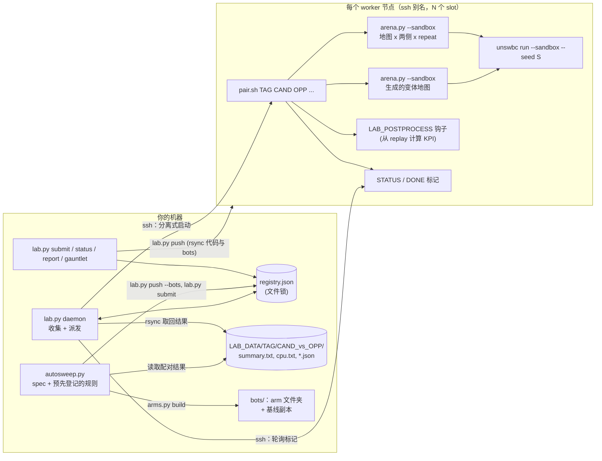

# infra：批量评测平台

[English](README.md)

这里是我们用来批量对战的全部工具：每天在一组 ssh 机器或一个 PBS 集群上跑数千局与评测机完全一致的 sandbox 对局，使用配对种子（paired seeds）和同种子基线（same-seed baseline），从而让同一个 bot 两个版本之间的小差异变得可以测量。除示例配置外，没有任何内容依赖我们的 bot；所有主机、用户、路径和队列都来自你自己的配置文件。

| 目录 | 内容 |
| --- | --- |
| [`config/`](config/) | 示例配置：`example.env`（环境变量）、`nodes.example.toml`（节点池）、`mapsets.example.toml`（地图集）、`judges.example.txt`（sweep 的评判对手） |
| [`lab/`](lab/) | ssh 节点池调度器 `lab.py`（registry、派发、收集、报告）、节点端 `pair.sh`、配对种子对局器 `arena.py`、CPU 检查 `cpu_check.py`、配置加载 `labconf.py` |
| [`sweep/`](sweep/) | `arms.py`（编译期宏的 arm + 同种子基线 + 配对报告）和 `autosweep.py`（持续运行的两阶段、预先登记规则的 sweep，并在新种子上确认），以及 `sweep_spec.example.json` |
| [`pbs/`](pbs/) | 通用 PBS 模板：单次 arena、CPU 普查、整个 census（`census.sh`）、后处理作业、replay 压缩、调参 island |
| [`tuning/`](tuning/) | 可选的旧版后端：对 bot 的 `Params` 做 island 模型 CMA-ES，对手是自我演化的 league |
| [`tests/`](tests/) | 调度器、解析器、sweep 规则和调参空间的单元测试 |

所有命令都在仓库根目录运行。bot 位于 unswbc 工作区 `bots/`（可用 `BC_BOTS_DIR` 覆盖）；一个 bot 就是其中的一个文件夹名（`abyss`、`starter` 等）。本地结果写入 `data/lab/`（`LAB_DATA`），不应纳入版本控制。

**用 infra 还是 tools？** [`tools/`](../tools/README.zh-CN.md)（可用 pip 安装的 `abyss_tools` 包）面向单台机器。这里的脚本是独立的（调度器、对局器和 sweep 只用 Python 标准库，所以工作节点只需要 `python3` 和 `unswbc`），用来驱动多台机器。两者使用同一套配对种子方案，结果可以逐个 slot 对比。注意 bots 目录的环境变量不同：tools 用 `ABYSS_BOTS`，infra 用 `BC_BOTS_DIR`。

## 架构



一次 **census** 是同一个 tag 下提交的一组 pair（候选 vs 对手）。一个 **pair** 是 `pair.sh` 在一个节点上的一次运行：候选在一组地图上与对手对战，两侧各打 `repeat` 次，再加上 `pv` 张生成的变体地图（两侧），全部在评测机的 sandbox 中运行。调度器是一个本地进程加一个 JSON registry：没有数据库，节点上不需要常驻程序，只用 `ssh` 和 `rsync`。在 PBS 集群上，同样的 census 由 `pbs/census.sh` 提交为一组作业，结果目录结构相同。

## 搭建节点池

1. **ssh 别名。** 在 `~/.ssh/config` 中为每台 worker 配一个别名；主机名、用户和密钥只放在那里，绝不放进本仓库：

   ```
   Host worker-a
       HostName <机器地址>
       User <你的用户名>
       IdentityFile ~/.ssh/<你的密钥>
   ```

   必须能用密钥非交互登录（`lab.py` 使用 `ssh -o BatchMode=yes`）。

2. **准备每个节点。** Linux，装有 `python3`、`rsync`、可选的 `zstd`，以及**与评测机相同版本的 unswbc**（我们用的是 1.2.9）。需要时在每个节点上固定版本，并在 `LAB_REMOTE_ENV` 中指向它（见 `config/example.env`）。每个节点先手动跑一局：第一次 sandbox 构建会编译评测机的工具链（约一分钟），之后的运行共享它。

3. **描述节点池。** `cp infra/config/nodes.example.toml infra/config/nodes.toml`，按 `别名 = slots` 列出。slot 是一个节点同时运行的对局数；**限制来自内存而不是核数**：一个大型 bot 的 sandbox 对局平均约 2.4 GB、峰值接近 4.4 GB，超出内存的节点会触发 OOM killer，悄无声息地丢掉对局。安全的规则是 `slots = min(核数 - 2, 内存GB / 4.4)`。

4. **环境变量。** `cp infra/config/example.env infra/config/lab.env` 并编辑。这些副本已被 git 忽略。每项设置也可以直接作为环境变量给出（优先于文件）。

5. **推送并检查。**

   ```sh
   python3 infra/lab/lab.py push            # 把 bots/ 和 infra/（LAB_PUSH）rsync 到每个节点的 <LAB_REMOTE_ROOT>
   python3 infra/lab/lab.py nodes           # 每个节点的负载、核数和正在运行的 pair
   ```

## 提交与收集一次 census

这里的 `abyss_base` 和 `abyss_ref` 是 bot 改名后的副本（`cp -r bots/abyss bots/abyss_base`）：前者是解读各 arm 时所对照的同种子基线，后者是作为对手的当前发布版本的冻结副本。

```sh
# 1. 排队：每个候选对每个对手，使用地图集文件中的一个地图集
python3 infra/lab/lab.py submit t1 "abyss_base abyss_arm1 abyss_arm2" "starter abyss_ref" --set official --repeat 2
python3 infra/lab/lab.py run --dry-run           # 一次派发现在会启动什么
# 2. 持续派发 + 收集（也可以自己调用 run 和 collect）
nohup python3 infra/lab/lab.py daemon --every 60 >> data/lab/daemon.out 2>&1 &
# 3. 查看
python3 infra/lab/lab.py status t1               # registry
python3 infra/lab/lab.py report t1               # 每个 pair 的胜负、95% Wilson 区间、CPU 失败、最差回合
python3 infra/lab/lab.py gauntlet t1             # 候选 x 对手，每个候选的平均值和最差对手
python3 infra/lab/lab.py replays t1 abyss_arm1_vs_starter   # 取回一个 pair 的 replay
python3 infra/lab/cpu_check.py data/lab/t1/abyss_arm1_vs_starter --limit 95
# 日常维护
python3 infra/lab/lab.py prio t1 "abyss_arm1_vs_starter" 1   # 数字越小越早
python3 infra/lab/lab.py cancel t1 [PAIR]                    # 删除待运行的 pair，正在运行的在节点上被终止
touch data/lab/PAUSE                                         # 不再启动新任务（节点维护）；删除文件即恢复
```

运行过程：

- `submit` 为每个（tag、候选、对手）在 registry 中加一条；重复项和自己对自己会被跳过。
- **派发**按优先级、再按提交时间排序待运行的 pair，把每个放到空闲 slot 最多的节点上，以分离方式启动（`nohup setsid`，无 stdin），ssh 立即返回。启动前先保存 registry，因此崩溃不会留下未记录的运行。
- **收集**询问每个忙碌节点的 `STATUS` / `DONE` 标记，用 rsync 把完成的 pair 取回（汇总、CPU 表、日志、钩子的 JSON，不含 replay），解析后记录胜负。
- **大 pair 调度：** 对局数超过 `big_games` 的 pair 至少要等到 `big_min` 个空闲 slot（如果在只剩两个 slot 的节点上启动，它会跑好几个小时）；等待期间，它会为自己保留最空闲的节点，不让更低优先级的 pair 使用，否则小 pair 会不断占用那里的零散 slot，大 pair 永远无法启动。小 pair 则填满其他地方的零散 slot。
- 结果位于 `$LAB_DATA/TAG/CAND_vs_OPP/{orig,pv}/`（`summary.txt`：每局一行，从候选的角度；`cpu.txt`：每局的最差回合和丢失的回合），钩子写出的话还有 `CAND_vs_OPP.json`。replay 留在节点上（zstd 压缩），直到 `lab.py replays` 取回。
- `LAB_POSTPROCESS`（可选）在对局结束后于节点上运行：`bash -c "$LAB_POSTPROCESS" _ CAND PAIR_DIR RUN_DIR...`，例如对新 replay 运行 [`tools/`](../tools/) 中的 KPI 脚本；`LAB_REPORT_CMD` 可在 `lab.py report` 后追加你自己的表格。

单台机器上，`infra/lab/arena.py` 就是不带调度器的同一个对局器：

```sh
python3 infra/lab/arena.py abyss starter --sandbox -j 8 --maps default arena maze --repeat 2 -o runs/abyss_vs_starter
```

## 统计方法

Battlecode bot 是一个庞大、有噪声的确定性系统，而两个版本之间值得发现的差异只有几个百分点。使用随机种子时，约 120 局的 census 对胜率的 95% 区间大约是正负 9 个百分点；大多数真实的改动比这更小。平台围绕以下五条规则构建。

1. **配对种子。** 一局的种子是它所在槽位（地图、候选执哪一侧、repeat）的哈希加上一个种子基数（`arena.py --seed-base`）。对同一个对手的每个候选，在同一个槽位上遇到相同的珍珠重生和相同的随机数，因此两个候选的结果差异来自它们的打法而不是运气。pair 之间逐槽位比较。换一个种子基数，就得到一组新的、独立的对局。`--fork` 让同一（地图、repeat）的两侧使用同一个种子：只改动终局的候选，在改动生效之前与对照组下出完全相同的棋局。

2. **同种子基线 arm，而不是 50%。** 在一组固定的配对种子上，即使完全相同的 bot 也不会得 50%：种子集合本身带有偏差（地图和执方的抽取）。因此每次 census 都包含一个未改动的 bot，以另一个文件夹名（`arms.py build` 生成 `<prefix>base_c`）在相同种子上运行，每个 arm 都按它与该基线的**配对差值**来解读（`arms.py report`：胜场、共同槽位上的差值之和、该和的 bootstrap 95% 区间、改变了结果的局数）。

3. **预先登记的规则、两个阶段、新种子。** `autosweep.py` 在对局开始前就在 spec 中固定决策规则：当一个 arm 的评判差值至少为 `judge_min`、镜像差值至少为 `mirror_floor` 时，通过第一阶段。镜像（arm 对你当前发布版本）是安全项：不能有显著退步（约为其对局的一个配对标准误），而不是优化目标。一次一个因子地筛选很多 arm 时，第一阶段的最好结果部分来自运气（赢家诅咒），因此通过者会在**新种子**和完整地图集上重跑，并与在这些种子上只跑一次的基线比较；只有两个阶段都通过的 arm 才成为候选。是否合并候选是另一个独立的决定。

4. **无效果规则。** 如果第一阶段所有 pair 中没有任何一局的结果与基线不同，说明这个旋钮没有改变这些对局（或者构建没有生效：只改头文件可能命中过期的 wasm 缓存，`arena.py` 和 `arms.py` 会清除它）。这样的 arm 标记为 `no-effect`，不进入确认：零差值不是旋钮有效的证据。

5. **安全闸门优先于结果。** 任何一个回合因 CPU 上限丢失，arm 都会被淘汰（`out-cpu`），无论得分如何。`cpu_check.py` 采用我们发布时使用的底线：在最大的地图、满单位数量下，没有 CPU 失败，也没有任何回合达到或超过 95 M 点（评测机在 100 M 点时终止）。对局总是使用 `--sandbox`：原生对局更快，但 bot 的搜索深度以及打法都与评测机不同。

`lab.py report` 中的区间是单个 pair 得分的 Wilson 区间（平局算半场），只描述这一个 pair。版本之间的决策应使用规则 1-2 的配对差值，它们要精确得多。这些数字如何用于决定改动，见 [`docs/methodology.md`](../docs/methodology.md)（英文）。

## 编译期宏的 sweep

代码包含 `ablation.hpp` 的载体 bot（`bots/abyss` 就是这样）无需修改即可产生变体：一个 arm 是载体的副本，在该文件末尾追加 `#undef NAME` / `#define NAME VALUE`。

```sh
# 手动：构建、运行（本地或 lab 上）、报告
python3 infra/sweep/arms.py build --carrier abyss --opp starter --macro BC_MN_DANGER_W=0.4,0.8 --prefix dw --out sweeps/dw
python3 infra/sweep/arms.py local --out sweeps/dw --maps default arena maze --repeat 2 -j 4
python3 infra/sweep/arms.py lab --out sweeps/dw --tag dw1 --set official --seed-base 7 --submit
python3 infra/sweep/arms.py report --out sweeps/dw --lab-dir data/lab/dw1

# 持续：准备 spec，运行 lab daemon，然后
python3 infra/sweep/autosweep.py arms   --spec infra/sweep/sweep_spec.example.json
python3 infra/sweep/autosweep.py run    --spec infra/sweep/sweep_spec.example.json --per-round 10 --every 600
python3 infra/sweep/autosweep.py report --spec infra/sweep/sweep_spec.example.json
```

sweep spec（`sweep/sweep_spec.example.json`）：

| 键 | 含义 |
| --- | --- |
| `name`、`prefix` | tag 前缀和状态目录（`$LAB_DATA/autosweep/<name>/`）；arm 文件夹为 `<prefix><轮次>x<k>_c`，基线为 `<prefix>base_c` |
| `carrier` | 用来构建 arm 的 bot 文件夹（必须包含 `ablation.hpp`） |
| `baseline` | 同种子基线文件夹（默认 `<prefix>base_c`）：除非同名文件夹已存在，否则作为载体改名后的副本构建 |
| `mirror` | 安全对手；如果 sweep 期间载体可能改变，请使用当前发布版本的冻结副本 |
| `judges_file` / `judges` | 评判对手（文件每次都会重读；新评判对手的基线 pair 会自动提交） |
| `reported` | 会对战并显示、但从不参与评判的对手 |
| `stage1`、`confirm` | 每部分（`mirror`、`judges`）：`maps` 或 `set`、`repeat`、`seed`（确认阶段的种子必须与第一阶段不同） |
| `rule` | `judge_min`、`mirror_floor`（得分差值，胜 1 / 平 0.5） |
| `prio` | 第一阶段、确认阶段和基线 pair 在 lab 中的优先级 |
| `arms` | `[MACRO, [v1, v2]]` = 每个取值一个 arm（一次一个因子），`{"defs": {...}}` = 一个组合 arm |

每一轮：读取 lab daemon 已收集的 pair，评判已完成的 arm（`no-effect`、`out-cpu`、`out`、`confirm`，然后是 `candidate` 或 `out-confirm`），在排队的第一阶段 pair 少于 `--max-pending` 时启动新一轮，重写 `report.md`。spec 用完且没有进行中的任务时停止。`--dry-run` 只打印 lab 调用而不执行。

## PBS 集群

`pbs/` 中的模板假定使用 PBS Pro（`qsub -v`、`-J` 数组作业、`-W depend=afterany`）。请在仓库根目录提交（PBS 运行前会复制作业脚本，因此脚本通过 `PBS_O_WORKDIR` 或 `REPO` 找到仓库），并用 `LAB_ENV` 传入 env 文件。每个作业使用作业私有的 unswbc 缓存，已编译的工具链通过符号链接共享，结束时压缩自己的 replay。

```sh
export LAB_ENV=$PWD/infra/config/lab.env
qsub -v LAB_ENV=$LAB_ENV,A=abyss,B=starter,EXTRA=--sandbox,MAPS=default:arena,REPEAT=2 infra/pbs/arena.pbs
qsub -v LAB_ENV=$LAB_ENV,BOT=abyss,OPP=abyss_ref infra/pbs/cpu.pbs          # 违反 CPU 底线时作业失败
bash infra/pbs/census.sh t1 "abyss_base abyss_arm1" "starter abyss_ref" 2  # arena 作业（+ 后处理作业）
qsub -v LAB_ENV=$LAB_ENV infra/pbs/compress.pbs
```

`census.sh` 写出与 lab 相同的目录结构（`$LAB_SCRATCH/census/TAG/CAND_vs_OPP/{orig,pv}`），因此 `arms.py report --lab-dir` 和 `cpu_check.py` 两者都能读取。

## 调参后端（可选，旧版）

`tuning/` 是我们在转向“按机制 KPI 评判策略改动”之前使用的 island 模型 CMA-ES。它仍然可用于 `bots/abyss`，后者的 `tuned_params.hpp` 为每个（地图组、对局阶段）保存每个旋钮的一个值。

```sh
uv run --with cma --with pycapnp python3 infra/tuning/cmaes_run.py --base abyss \
    --space infra/tuning/space.example.json --out runs/isl0 --jobs 16 --budget 0.015 --paired --gens 40
```

- `space.py` 从 JSON 读取搜索空间（边界；每个旋钮一个维度、每个地图组一个维度，或每个（组、阶段）一个维度），并写出 `tuned_params.hpp`。基础头文件中未参与调参的字段按原文保留；在起点处生成的头文件除第一行注释外与基础头文件完全相同，因此一次运行严格从发布版本出发。
- `cmaes_run.py`：每一代的候选以缩减的搜索预算（`eval_budget.hpp`）与 league 成员对战；适应度 = 胜 1 / 平 0.5 / 负 0，加上一个很小的长度差值项用于打破平局。`--paired` 让同一代的所有候选使用相同的对手、地图和种子（公共随机数）：没有它，20 局的排名大多是噪声，均值会漂移。值得进一步测试的是 CMA 均值（`mean_params.hpp`），而不是单个最佳候选。
- `league.py`：在参考 bot、各 island 的名人堂快照、额外对手文件夹和冠军之间做优先虚拟自我对弈（PFSP）（`champion.py` 加冕冠军：我们使用最近一次发布的版本，而不是验证器的最高分，后者在固定参考对手上会饱和）。
- PBS 上的 island：`qsub -J 0-3 -v LAB_ENV=$LAB_ENV infra/pbs/islands.pbs`（每个索引对应 `tuning/islands.example.txt` 的一行）；`keep_islands.sh` 会在 walltime 结束后重新提交 `$EVO_ROOT/islands_active.txt` 中列出的索引。

经验：在已经正确的策略上做小维度调参是值得的（一个模块的少数旋钮，最多约 30 维，使用配对种子）。调出的均值和其他改动一样只是候选：在替换任何东西之前，必须在完整预算下通过配对 census 和 CPU 普查。只在调参参数上不同的两个版本往往输掉同样的对局；遇到这种情况，应改策略而不是改数字。

## 测试

```sh
uv run --with pytest python -m pytest infra/tests -q
```

测试覆盖调度器的放置规则、输出解析器（使用真实的 unswbc 输出）、TOML 与 env 加载器、使用假 lab 的 sweep 阶段状态机，以及调参空间（包括逐行重新生成 `bots/abyss/tuned_params.hpp`，注释行除外）。它们不需要节点，也不进行任何对局。
